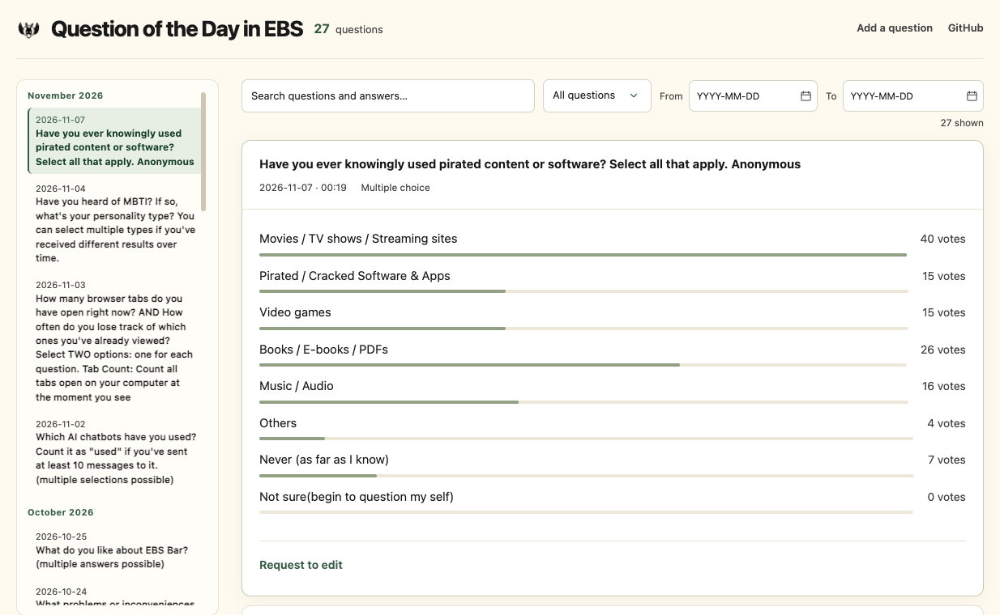
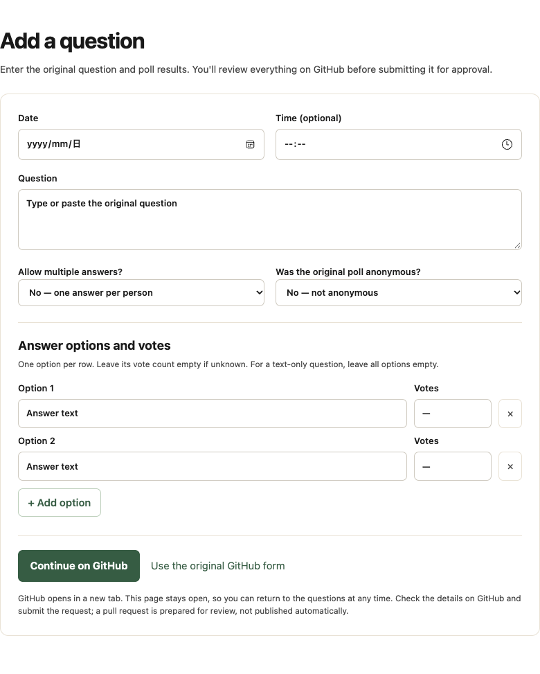

# Question of the Day in EBS

A searchable archive of questions and aggregated poll results from the **EBS-Socializing WhatsApp group**.

**[Open the website](https://the-aries.github.io/question-of-the-day-in-ebs/) · [Add a question](https://the-aries.github.io/question-of-the-day-in-ebs/add.html)**

## How to

**Find:** Search or filter questions, then expand a card to view answers and vote counts.

**Add:** Open **Add a question**, fill in the question and option votes, then select **Continue on GitHub**.

**Edit or delete:** Expand a card → **Request to edit**. Correct the details or choose **Request deletion instead of editing**.

**Review:** A GitHub Issue creates a pull request (PR). A maintainer reviews and merges it before the website updates.

A GitHub account is required to submit requests; no coding is needed. See [CONTRIBUTING.md](CONTRIBUTING.md) for details.
